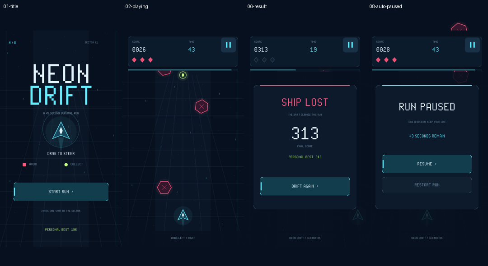

# Verification — 2026-11-13

Verified locally with Haxe4.3.6, JDK21, SDK35, NDK28.2.13676358 and CMake3.30.3 on Debian. The debug APK was built for ARM64 and x86_64, then installed on an Android30 x86_64 emulator with GLES3.

- Model suite: **62 assertions, 0 failures**, covering movement bounds, time, pause, collisions/invulnerability, pickups, win/loss, deterministic spawning, restart and strict saved-score validation.
- APK: valid v2 signature; native game, HashLink, SDL and C++ runtime libraries present for both ABIs. SDL_main exports from the game library; HashLink JNI_OnLoad and hl_sys_special export from libhl.
- Visible title verified using **31,326 cyan pixels** in an actual screenshot, preventing the earlier blank-output regression.
- Touch play, both movement limits, manual pause/background/resume, loss result, restart and automatic focus-loss pause exercised.
- Fresh resume logs confirm manual pause held at **41 seconds** and automatic pause held at **43 seconds** while backgrounded.
- Run ended with score/best **313**. Restart reset score to0 and time to45 while retaining best313. Force-stop/relaunch returned to title with best313 and identical private save-file contents.
- No fatal JNI/native/Java crash in the acceptance logs.
- The official Base2D sample also compiled to JavaScript and passed `node --check` after the native-only uniform correction.

Local verified APK SHA-256: `8ac2d8b9cf14e786cb74c11bdc8b45478c9ac6b65472574b1ec1fb36286fb062`.

`emulator-report.json` and `apk-report.json` retain the structured checks. Full screenshots, signature output and runtime logs are generated under ignored `dist/verification/` by the scripts.

The emulator run exercised a loss result; the model suite covers the win transition. Physical ARM64 runtime testing remains for an Android device. The APK is debug-signed. Upstream native sources emit compiler/deprecation warnings; builds reject unresolved application symbols.

GitHub Actions separately builds the same pinned source stack and verifies signatures/ABIs. CI artifact signatures and hashes can differ from this locally built APK.

## GitHub Actions artifact

[Run 43474697561](https://github.com/Fanorisky/heaps-android-starter/actions/runs/43474697561) completed successfully for commit `0525912`:62 assertions, both ABI builds, signature/entry checks and artifact upload passed.

The downloaded CI APK was checksum-verified and separately installed/tested on the emulator. The complete title/rendering, touch, pause/background, results/restart and persistence gate passed again. See `ci-emulator-report.json`.

CI APK SHA-256: `b02c0633714397ffb30af329b7cbf1c997888a1b519c2e69d302f70b90b1ae31`.
