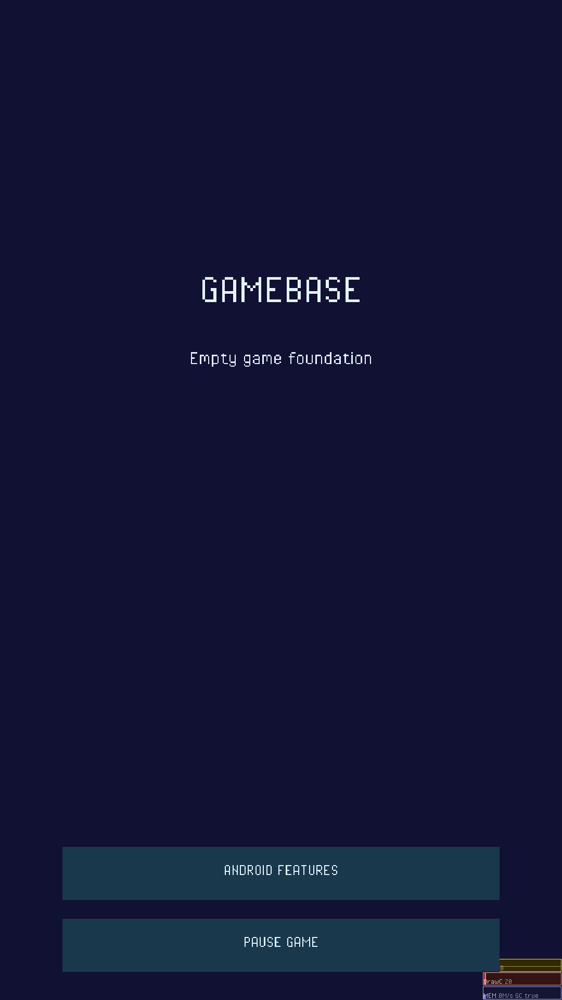

# GameBase Android v0.3.0 verification

Local Debian validation on 2026-11-14 with Haxe4.3.6, JDK21, SDK35, NDK28.2.13676358 and CMake3.30.3.

- `scripts/build-apk.sh --variant=debug` passed for ARM32/ARM64/x86_64. APK signature, native architectures, Boot entry point and platform/audio exports passed.
- Normal and `-debug` GameBase HLC typechecks passed, including retained UI/entity helpers. GameBase master is pinned at a7af1d70dbbf62d7fc09cb05431ced606e0ed809.
- Pure GameBase session pause/screenshot ownership, platform (36 checks), storage/preferences (56 checks), Unicode editor (9 checks), settings (10 checks) and audio/pause-policy suites passed. Java dispatch, ASan/UBSan platform/audio-gate and real Heaps CPU hook tests passed.
- Fresh/idempotent/published-v0.2/incompatible patch matrix and byte-for-byte WAV fixture reproduction passed.
- The exact packaged three-ABI APK installed on Android30 x86_64 emulator and rendered the empty GameBase foundation. The complete Features scenario passed: wrapped/raw audible/muted virtual channel freezes, user pause/fades, SDK shutdown/reinitialize, genuine paused recovery, ten HOME/return cycles with independent native background snapshots, text/preferences, sensor/haptic requests, Features exit and explicit GameBase resume. Preferences survived process restart.
- Native speaker/Bluetooth audibility, physical haptic sensation, latency/battery and ARM device runtime remain unmeasured here. This local APK uses an ephemeral Android debug certificate; stable proof CI signing is unchanged and was not performed locally.

APK SHA256: `71d69b525f55e26851dd3309367bc32a16ba126b7ed8f5b3265eb801d28d1c8d`.

An early lifecycle run on the initial migration failed its virtual-channel snapshot tolerance; a subsequent run passed. The fixture now samples after the real audio Manager in MainLoop, retaining the same freeze tolerance, and the final packaged APK passed the complete scenario. First cold emulator boot also needed services to settle before test installation/log setup; the runner now waits for boot completion.

The previous arcade game and its score/model/art are removed. Historical verification records apply only to their recorded old artifacts.

