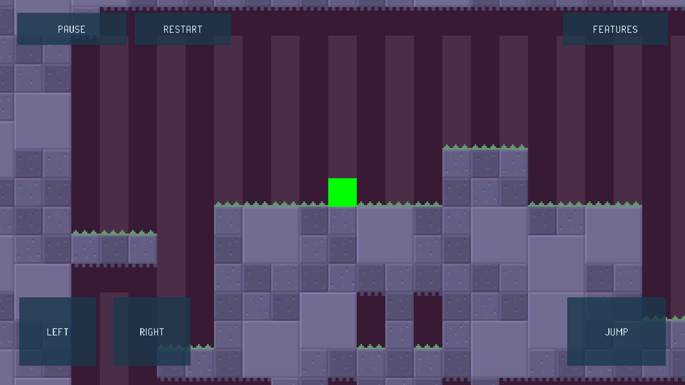

# Playable GameBase Android v0.3.1

Restores deepnight/gameBase's original SampleGame, SamplePlayer and LDtk sample level at pinned revision a7af1d70dbbf62d7fc09cb05431ced606e0ed809. Android defaults to landscape and starts gameplay directly. Hold LEFT/RIGHT and tap JUMP; the touch state supports independent fingers. PAUSE/RESUME, RESTART and a secondary FEATURES panel remain available.

Verified locally on 2026-11-14:

- Haxe4.3.6 normal/debug typechecks, pure session/modal pause and per-finger touch tests, platform/storage/settings/editor/audio policies, sanitized native gate/platform checks, Java dispatch, pinned patch matrix and WAV reproduction passed.
- The actual packaged APK built for ARM32/ARM64/x86_64 and passed signature, architecture, Boot entry and native platform/audio checks.
- The exact packaged APK installed on Android30 x86_64 emulator. Screenshot dimensions were 1920x1080. Touch right/left changed the real player's position, jump entered the sample jump path, and restart recreated the level/player. The original level and green player were visible.
- Wrapped/raw audible/muted audio regression, SDK restart, ten HOME/return cycles, paused recovery, keyboard/preferences, sensor/haptic API requests, feature screen exit, explicit game resume and preferences across process restart all passed.
- Review fixes preserve controller input locks for touch and modal-owned gameplay pauses. Closing a modal preserves an existing user/lifecycle pause.

APK SHA256: `ec81447644adcd8895542fdc521a4438c2137b331810598d7798a62dd726044d`. Local artifact uses the ephemeral Android debug certificate; stable proof signing stays in CI. Physical speaker/Bluetooth, haptic sensation, ARM-device runtime and performance are not established by this emulator run.

Early long test attempts ended when the emulator process exited or adb became unavailable during concurrent native compilation. The final packaged-APK acceptance run completed successfully; interrupted runs are not recorded as passes.

