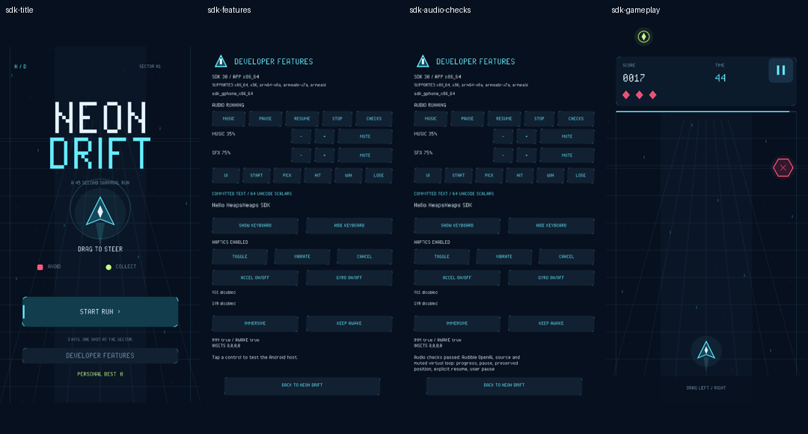

# Heaps Android SDK proof v0.2.0

[Actions run43524533775](https://github.com/Fanorisky/heaps-android-starter/actions/runs/43524533775) passed for source36a15d9. The downloaded stable proof APK passed certificate/native library/ABI verification and the full Android30 x86_64 proof scenario.

Evidence:
- Original62 game assertions plus platform27, storage56, legacy3, editor9, events10, settings10 and audio policy checks pass.
- Native UTF16/UTF8 ingress, text cancellation, lifecycle queues/sensor packets and audio gate/generation/lifetime tests pass with ASan/UBSan.
- Real Heaps Manager/OpenAL sources pass source-exhaustion cleanup, live bus changes, audible-source processing, muted virtual music progress/freeze, explicit resume and user-pause retention.
- Cold-start preferences report PREFS_TEST_PASS and correct35%/75%/true defaults. AudioFlinger showed an active app-owned stream before any control was pressed.
- IME ASCII entry persisted and survived process restart. Full multi-character/nonBMP ingress is covered by the real native encoder/decoder regression.
- Sensor controls responded; background handling and explicit audio resume passed. Native windowed mode reported FORCE_NOT_FULLSCREEN, systemUI0 and actual66/132 insets.
- Customized package/name/landscape/windowed configuration launched the unchanged generic host namespace without source mutation.
- Stable test certificate955cd26e9de2c1da3cde91b282886d12dc70c39b41172d2c74045568ea5a38d2 matches local and CI artifacts; Android accepted the CI APK as an update without uninstall.

APK SHA256:93bcd1e1fc19a401094617e7b4dacc1336bda339a1733cc60b4b4e7bb38b06cd.

ARM32/ARM64/x86_64 compile/link/package checks passed. Physical phone speaker audibility, vibration sensation, and new physical ARM32 SDK behavior remain user device checks. Stream/channel progression is not a listening test. The known emulator ARM32 NativeBridge setjmp/longjmp limitation is not hidden by disabling exception handling.
